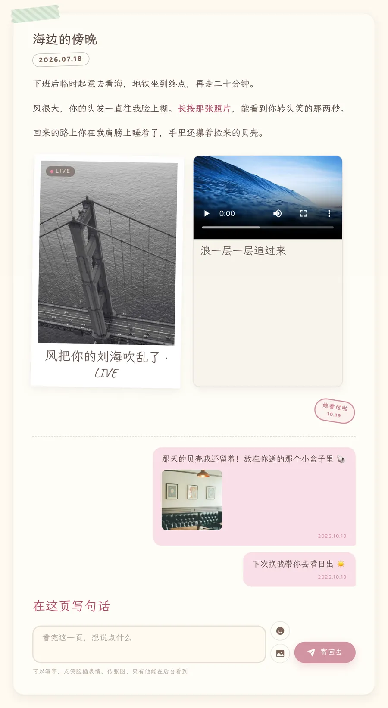
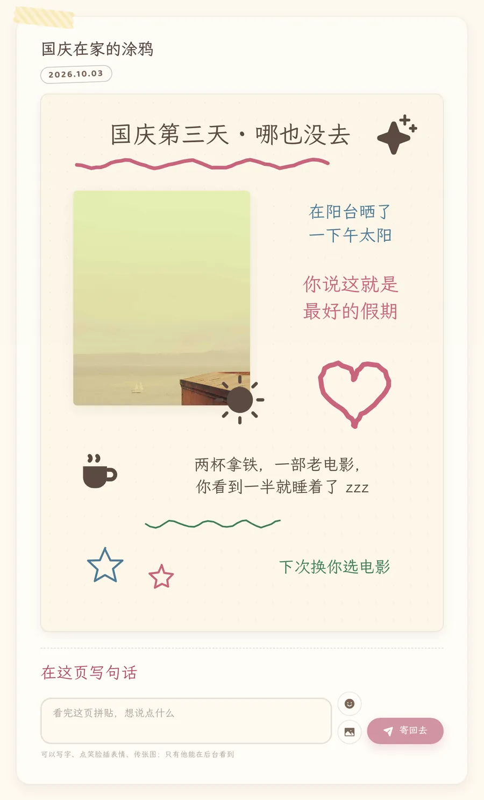
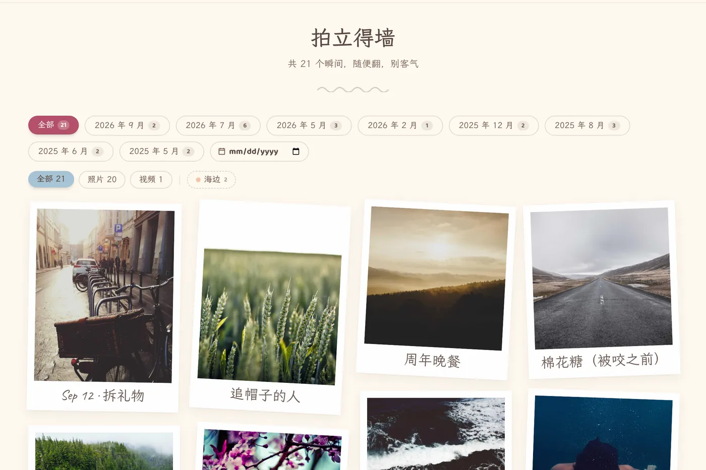
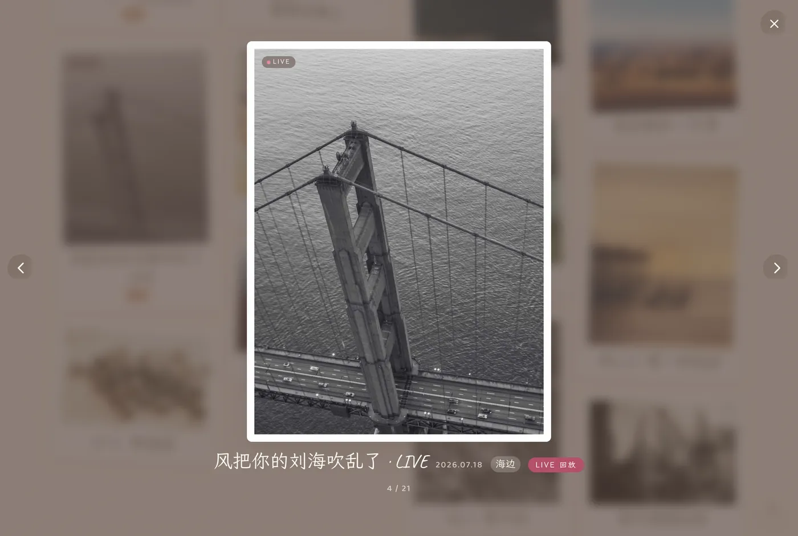
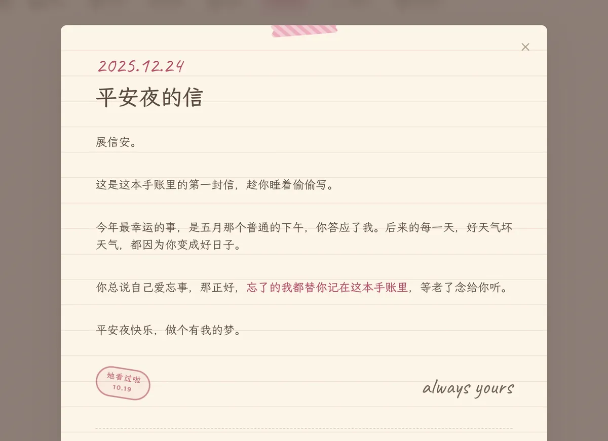
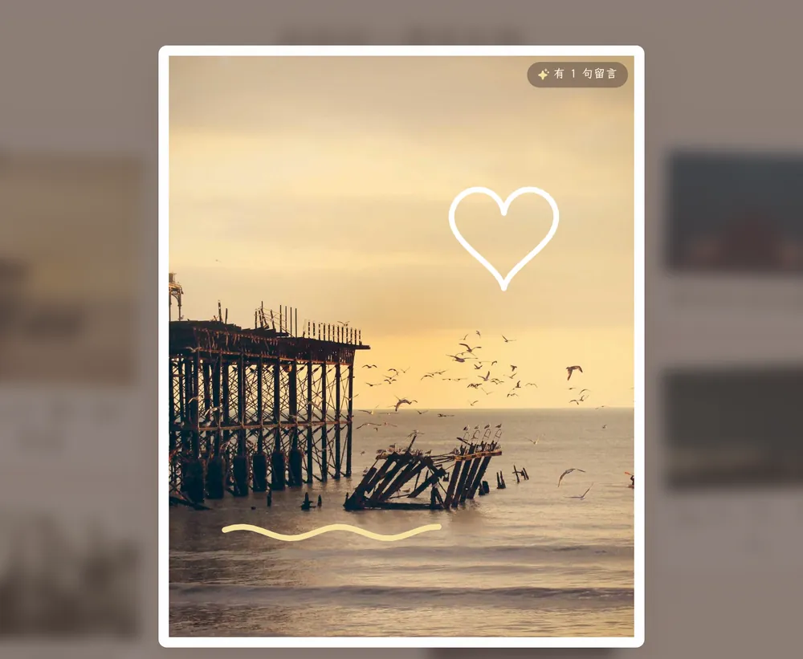
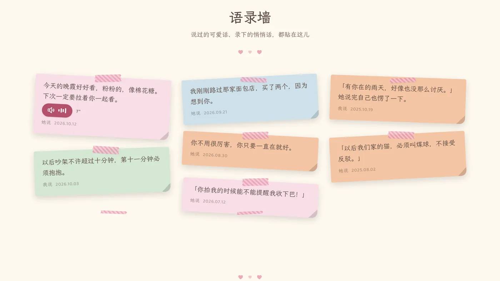
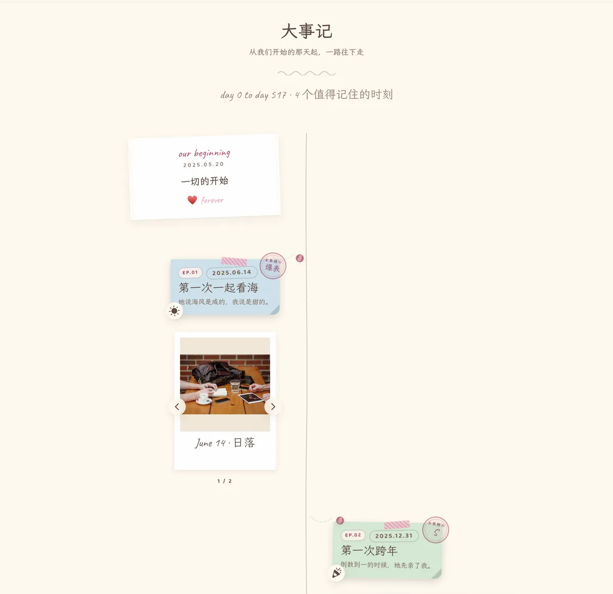
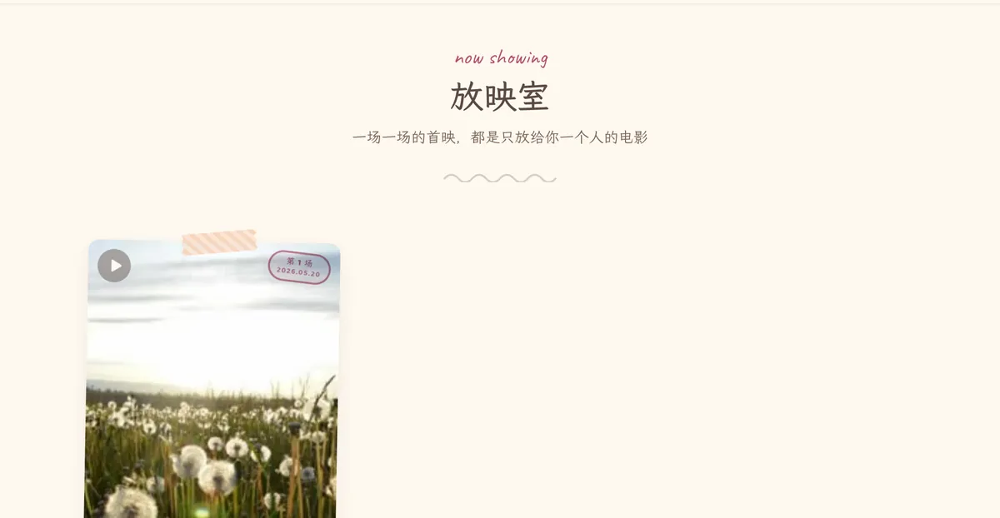
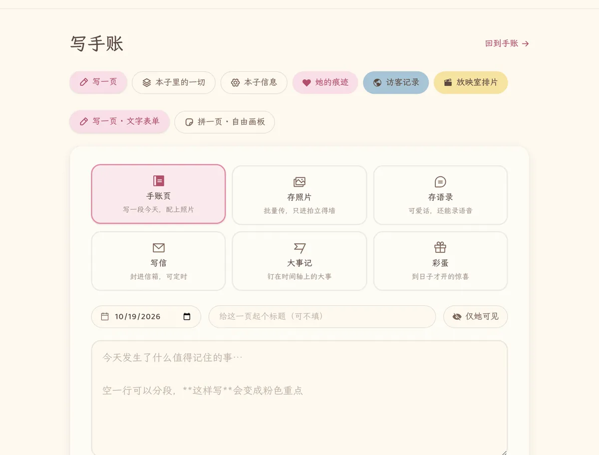

<div align="center">

# 我们的小星球 · 恋爱电子手账

一本只属于你们俩的电子手账：文字、涂鸦、照片、实况、视频、语音、信，都贴在奶油纸页上。<br>
上了锁，谢绝搜索引擎，等某一天作为惊喜送给她——然后看她在每一页留下痕迹。

**Next.js 16 · React 19 · SQLite · 自托管 · 手机优先**


</div>

> 截图里的照片来自 [Picsum](https://picsum.photos)（Unsplash 图库），文字和语音都是演示数据。

---

## 目录

- [核心功能](#核心功能)
  - [手账：写字，也能自由涂鸦](#1-手账写字也能自由涂鸦)
  - [相册：实况、视频、照片，每张都能写一句](#2-相册实况视频照片每张都能写一句)
  - [她的回应：「看过啦」印章 + 回信](#3-她的回应看过啦印章--回信)
  - [后台：她留下的每一道痕迹](#4-后台她留下的每一道痕迹)
  - [彩蛋：到日子、对上密码才打得开的惊喜](#5-彩蛋到日子对上密码才打得开的惊喜)
  - [快捷指令速记：`/api/quick`](#6-快捷指令速记apiquick)
- [其他栏目](#其他栏目)
- [快速开始](#快速开始)
- [环境变量](#环境变量)
- [日常怎么用](#日常怎么用)
- [页面一览](#页面一览)
- [部署](#部署)
- [阿里云 OSS（可选）](#阿里云-oss可选)
- [脚本](#脚本)
- [隐私与安全](#隐私与安全)
- [技术栈与设计](#技术栈与设计)
- [许可证](#许可证)

---

## 核心功能

### 1. 手账：写字，也能自由涂鸦

两种纸页，在 `/journal` 里像翻纸质书一样一页一页翻（← → 键、按钮、左右滑动；顶部月份贴纸按月跳，日历直选某天）。

- **手账页**：一段文字配一组照片 / 视频 / 实况，贴一枚心情贴纸。正文空一行分段，`**这样写**` 是粉色重点。
- **自由拼贴页**：一张 3:4 的纸，想怎么排就怎么排——三种字体四种颜色的文字、拖进来的图片、内置贴纸或自己上传的可爱图（进「我的贴纸」库，下次直接用）、**四色画笔随手涂鸦**；拖拽移动、右下角缩放、双击改字、撤销都有。

<table>
  <tr>
    <td width="50%"></td>
    <td width="50%"></td>
  </tr>
  <tr>
    <td align="center">手账页：文字 + 实况照片 + 视频，下面是她的印章和回话</td>
    <td align="center">自由拼贴页：文字、贴纸、图片、手绘涂鸦</td>
  </tr>
</table>

### 2. 相册：实况、视频、照片，每张都能写一句

`/album` 是一面拍立得墙，按月份、照片 / 视频、标签筛选，点开进灯箱（← → 翻页，Esc 关闭）。

- **iPhone 实况照片（Live Photo）**：同名的照片 + 视频（`IMG_1234.HEIC` + `IMG_1234.MOV`）一起选进来自动配对，`.livp` 自动拆包；墙上长按播放，灯箱里点「LIVE 回放」。也能手动把一段视频配到它前面的照片上。
- **视频**：原样保存（单文件最大 2GB），服务器用 ffmpeg 抽第一帧做封面；HEVC 编码的视频会带角标提醒（桌面 Chrome 可能放不了）。
- **静态照片**：自动压缩、生成 WebP 缩略图；HEIC 自动转 JPG；读 EXIF / 视频元数据里的真实拍摄时间，按日期自动分页。
- **每张都能写描述**：拍立得下面那行手写字就是它的描述，灯箱里随时改描述、改日期、贴标签（「青海之行」这类，相册能按它筛）。

<table>
  <tr>
    <td width="50%"></td>
    <td width="50%"></td>
  </tr>
  <tr>
    <td align="center">拍立得墙：按月 / 类型 / 标签筛选</td>
    <td align="center">灯箱：LIVE 徽章、描述、日期、标签、实况回放</td>
  </tr>
</table>

### 3. 她的回应：「看过啦」印章 + 回信

本子不是单向的。她用密码进来以后：

- 每一页手账、每一封信、每一场放映的末尾，都有一枚淡淡的虚线章「看过就盖个章」——她点一下，「啪」地盖实成 **「她看过啦 · 日期」** 的红墨印章，每页一枚，盖过就一直在；
- 页脚有一个回话框：**文字 + 表情 + 图片**（GIF 表情包保持会动），像回信一样「寄回去」。回话会一直留在那一页下面。

<p align="center"></p>
<p align="center"><sub>信箱里拆开的一封信：信末是她的印章，下面是她写回来的话</sub></p>

### 4. 后台：她留下的每一道痕迹

作者后台（`/write`，用作者口令进入）里有两本「账」：

- **她的痕迹**（`/write/marks`）：她寄回来的每一句话（连同配图、来自哪一页）、她盖过的每一枚章，按时间排好。
- **访客记录**（`/write/visitors`）：没登录的人翻开过哪些页——大致城市、运营商、设备、翻页轨迹；爬虫自动识别、另行标记。她和你登录后的浏览不会被记录。

<table>
  <tr>
    <td width="50%"></td>
    <td width="50%"></td>
  </tr>
  <tr>
    <td align="center">她的痕迹</td>
    <td align="center">访客记录</td>
  </tr>
</table>

### 5. 彩蛋：到日子、对上密码才打得开的惊喜

在 `/write` → 彩蛋 里可以埋任意多个，每个彩蛋都有：

1. **揭晓日期**：那天之前，彩蛋在列表和详情页都完全不存在（接口层面封印，不是视觉遮罩）；
2. **单独的密码**：到了日子她还得输入一串只有你们知道的字；
3. **精选照片**：从整本相册里挑一批，按你点选的顺序展示；
4. **一封信**：揭晓时刻展开。

拆开以后是封面「翻开它」→ 照片墙 → 长信 → 结尾的实时天数。**她可以在每张照片上手绘留言**（4 色画笔、2 档粗细、撤销），留言存在服务器上：后台彩蛋列表里看得到她留了几句，你预览彩蛋时就能看到她画了什么。后台一键复制彩蛋链接发给她。

<table>
  <tr>
    <td width="33%"></td>
    <td width="33%"></td>
    <td width="33%"></td>
  </tr>
  <tr>
    <td align="center">到日子才出现的密码门</td>
    <td align="center">精选照片墙（「有话」= 她画过）</td>
    <td align="center">她在照片上画下的留言</td>
  </tr>
</table>

本子里还藏着一些不写在导航上的小彩蛋：

- 夜里 23 点到凌晨 5 点翻开首页，月亮和小星星会出来眨眼睛；
- 首页问候语按时段换（「这么晚还没睡呀」「午安，记得好好吃饭」……）；
- 「这本本子记得」：每天从「N 个月前的今天」翻出一页回忆；
- 首页大拍立得点一下会 3D 翻到背面，背面是手写的一句话；
- 纪念日月历自动算出整百天、520 天、1314 天、每个周年，再叠上情人节、520、元宵、七夕；
- 「本月我们」月度结算单、大事记走到底的「本季糖分结算单」（甜度计会爆表）。

### 6. 快捷指令速记：`/api/quick`

在微信里看到她说了句好玩的、或者此刻特别想记一笔，不用打开后台——用 iPhone 快捷指令直接投进本子。鉴权用独立令牌（`Authorization: Bearer <SHORTCUT_TOKEN>`），泄露了换掉环境变量即可作废，不影响作者口令。

| 想做的事 | 请求 |
|---|---|
| 存一句语录 | JSON：`{"type":"quote","text":"她说的那句话","speaker":"她说"}` |
| 记一篇手账（带照片 / 视频 / 实况） | multipart：`type=journal` + `title` / `text` / `date` + 任意文件字段 |
| 只存进相册 | multipart：`type=photo` + 文件（`text` 可选，作为相册备注） |
| 语音语录 | multipart：`type=quote` + 文件字段 `audio`（`text` 可留空，也可文字 + 语音一起） |
| 一次多选很多照片 | 把照片和视频打成一个 `.zip` 作为文件字段 `media` 上传（最多 9 项，实况算 1 项） |
| 大视频（最大 2GB） | 三步直传：`POST /api/quick/prepare` 拿地址 → `PUT` 文件 → `POST /api/quick` 带 `media` 登记 |

```bash
# 一句语录
curl -X POST https://你的域名/api/quick \
  -H "Authorization: Bearer $SHORTCUT_TOKEN" \
  -H "Content-Type: application/json" \
  -d '{"type":"quote","text":"你不用很厉害，你只要一直在就好。","speaker":"她说"}'

# 一篇手账：实况（同名照片 + 视频自动配对）+ 一段视频
curl -X POST https://你的域名/api/quick \
  -H "Authorization: Bearer $SHORTCUT_TOKEN" \
  -F type=journal -F title="海边的傍晚" -F text="风很大……" \
  -F file1=@IMG_0718.HEIC -F file2=@IMG_0718.MOV -F file3=@VID_0718.mp4

# 一条语音语录
curl -X POST https://你的域名/api/quick \
  -H "Authorization: Bearer $SHORTCUT_TOKEN" \
  -F type=quote -F text="今天的晚霞好好看" -F audio=@voice.m4a
```

- `date` 缺省为今天（`YYYY-MM-DD`），`speaker` 缺省为「她说」；
- HEIC 服务端自动转 JPEG，`.livp` 自动拆包配对；录音时长由 ffmpeg 读出；
- multipart 单次附件总量 ≤ 150MB（要整包读进内存），更大的走三步直传——配了 OSS 时文件直接从手机传到 OSS，**不经过应用服务器**。

手机上的逐步配置见：

- [快捷指令：多选上传手账与相册](docs/iphone-shortcuts.md)
- [快捷指令：贴语录（文字 / 录音 / 文字 + 录音）](docs/iphone-shortcuts-quotes.md)
- [快捷指令：大视频直传](docs/iphone-shortcuts-bigvideo.md)
- [快捷指令：上传失败排查](docs/iphone-shortcuts-debug.md)

---

## 其他栏目

| | |
|---|---|
| **语录墙** `/quotes` | 便利贴墙。存语录时可以现场录一段（最长 5 分钟）或导入音频文件，墙上是微信式的语音气泡，点一下播放、声波跳动 |
| **信箱** `/letters` | 点信封拆信，米色横线信纸全屏阅读，未读的封着火漆。**定时信**：选一个拆信日期，那天之前只有你能看到 |
| **大事记** `/timeline` | 手动录入的里程碑时间轴，每条配照片 / 视频和贴纸图标；可配一首背景音乐 + LRC 歌词逐行跟唱 |
| **放映室** `/screenings` | 每一段完整的纪念视频是一场「首映」：片名、导演寄语、首映日期（到日子才能看） |
| **访客模式** | 每个栏目、每一页都能单独设成「公开」或「仅她可见」，给朋友看一部分，其余是悄悄话 |
| **深色模式** | 夜晚的小星球：暖调深梅棕的纸；跟随系统，也能手动切换 |

<table>
  <tr>
    <td width="50%"></td>
    <td width="50%"></td>
  </tr>
  <tr>
    <td width="50%"></td>
    <td width="50%"></td>
  </tr>
</table>

---

## 快速开始

需要 Node.js 20+；推荐装上 ffmpeg（读视频 / 录音时长、抽视频封面，`brew install ffmpeg` / `apt install ffmpeg`）。

```bash
npm install
cp .env.example .env.local   # 然后编辑 .env.local（见下）
npm run seed                 # 填一本示例手账（之后在 /write 里删掉换成自己的）
npm run dev                  # 打开 http://localhost:3000
```

用 `.env.example` 里的默认值时，读者密码是 `0520`，作者口令是 `write-for-her`。

## 环境变量

写在 `.env.local` 里：

| 变量 | 用途 | 默认 |
|---|---|---|
| `AUTH_SECRET` | 签名密钥，`openssl rand -hex 32` 生成一次，别换 | 无（必须设置） |
| `READER_PASSWORD` | 解锁手账的密码，给她用的，建议用纪念日数字 | `0520` |
| `AUTHOR_PASSWORD` | 作者口令，你自己记内容用，别告诉她 | `write-for-her` |
| `AUTHOR_SESSION_HOURS` | 作者会话几小时后过期（登录时勾「这台设备是我自己的」则 30 天） | `6` |
| `NEXT_PUBLIC_READER_NAME` | 界面上对她的称呼：「仅她可见」「她的专属入口」……换成她的昵称 | `她` |
| `SHORTCUT_TOKEN` | 快捷指令速记通道的令牌，`openssl rand -hex 24` 生成；不设置则通道关闭 | 无（可选） |
| `FFMPEG_PATH` | ffmpeg 可执行文件路径；不设置则用系统 PATH 里的 | 无（可选） |
| `OSS_BUCKET` / `OSS_ENDPOINT` / `OSS_ACCESS_KEY_ID` / `OSS_ACCESS_KEY_SECRET` | 阿里云 OSS，四项都填才启用（见下） | 无（可选） |

改了 `AUTH_SECRET` 或 `NEXT_PUBLIC_READER_NAME` 需要重新 `npm run build`。

## 日常怎么用

- **记内容**：打开 `/write`，输入作者口令。「写一页」里有六张类型卡：手账页（还能切成自由画板）、存照片、存语录、写信、大事记、彩蛋。各栏目页头的虚线小按钮（仅作者可见）直达对应表单，比如 `/write?type=quote`。
- **本子里的一切**：全部内容的统一管理，按类筛选、带缩略图，随手编辑、删除、切换公开 / 仅她可见（彩蛋行还能复制链接）。
- **本子信息**：改本子名字、封面上的两个人、在一起的纪念日（首页天数从这天算）、访客模式的栏目开关、大事记的背景音乐和歌词。
- **上传**：手机相册直接多选；拍摄日期自动读取，「存照片」会按各自的拍摄日期自动分页；写手账页时表单日期会自动对齐拍摄日期（手动改过就不覆盖）。
- **实况怎么才不丢**：iPhone 相册里「存储到文件」只会导出静态图。要留住实况：AirDrop 发到 Mac，或在 Mac「照片」App 里「文件 → 导出 → 导出未修改的原片」，得到同名的一对文件；没有 Mac 就用 iCloud 网页版下载原图，或者直接用快捷指令上传。
- **视频在电脑上放不了？** 多半是 HEVC 编码。把 iPhone「设置 → 相机 → 格式」改成「兼容性最佳」，拍出来就是通用的 H.264。

<p align="center"></p>

## 页面一览

| 路径 | 内容 |
|---|---|
| `/` | 在一起 N 天、大拍立得、最近一页、「这本本子记得」、纪念日月历、月度结算单 |
| `/journal` | 手账本：手账页 + 自由拼贴页，翻书式浏览 |
| `/album` | 拍立得墙 + 灯箱 |
| `/quotes` | 语录便利贴墙（文字 + 语音气泡） |
| `/letters` | 信箱 |
| `/timeline` | 大事记 |
| `/screenings` | 放映室 |
| `/someday/[id]` | 彩蛋（不在导航里，到日子把链接发给她） |
| `/lock` | 日记本锁扣（读者密码 / 访客模式入口） |
| `/write` | 写作后台（作者口令）；`/write/marks` 她的痕迹，`/write/visitors` 访客记录，`/write/screenings` 放映室排片 |

## 部署

需要一台能跑 Node 20+ 的常驻机器（轻量云服务器即可）：

```bash
# 服务器上
git clone <你的仓库> our-little-planet && cd our-little-planet
cp .env.example .env.local && vim .env.local
npm ci && npm run build
pm2 start "npm run start" --name journal       # 或用 systemd
```

- 用 Nginx / Caddy 反代 3000 端口并配上 HTTPS。Nginx 示例见 [`deploy/nginx.conf.example`](deploy/nginx.conf.example)（含 500MB 上传上限和 `/api/quick` 的 JSON 错误页），`DOMAIN=你的域名 bash scripts/apply-upload-limit.sh` 可一键安装并平滑重载。
- 小内存服务器不想在线上构建：`DEPLOY_HOST=服务器别名 DOMAIN=你的域名 bash scripts/deploy.sh` 会在本机构建、只上传产物、换名重启，失败自动回退。
- 给服务器设 `TZ=Asia/Shanghai`（或你们所在的时区），保证「在一起 N 天」按时区翻页。
- **备份 = 备份 `data/` 文件夹**（`journal.db` + `media/`），拷走一份就不会丢。

## 阿里云 OSS（可选）

默认照片视频存在服务器 `data/media/`。配置 OSS 后自动切换为**浏览器直传 OSS**，大文件不占服务器带宽：

1. **建 Bucket**：地域选离你们近的，读写权限设为**私有**；
2. **建 RAM 子账号**：只授予该 Bucket 的 `PutObject / GetObject / DeleteObject`，不要用主账号 AccessKey；
3. **配 CORS**（OSS 控制台 → 数据安全 → 跨域设置）：来源填 `http://localhost:3000` 和你的正式域名，Methods 允许 `PUT, GET`，Headers 允许 `*`，暴露 `ETag`；
4. **填 `.env.local`**：`OSS_BUCKET` / `OSS_ENDPOINT`（如 `oss-cn-hangzhou.aliyuncs.com`）/ `OSS_ACCESS_KEY_ID` / `OSS_ACCESS_KEY_SECRET`；
5. **迁移旧内容**（可选）：`npm run migrate-oss`，本地文件保留作备份。

读取仍走 `/api/media/[id]`：OSS 模式下 302 到现签的临时地址（1 小时有效）；删除条目时同步删除 OSS 对象。

## 脚本

| 命令 | 作用 |
|---|---|
| `npm run seed` | 填一本示例手账（会清空现有内容，只在新本子上用） |
| `npm run convert-heic` | 把库里存量的 HEIC 照片批量转成 JPG |
| `npm run gen-posters` | 给已有视频补封面 |
| `node scripts/gen-thumbs.mjs` | 给已有照片补 WebP 缩略图 |
| `npm run backfill-fingerprints` | 给已有照片视频补内容指纹（用于「这张传过了」提示） |
| `npm run migrate-oss` | 本地媒体迁移到 OSS |
| `node scripts/batch-upload.mjs <文件夹>` | 把一个文件夹的照片 / 视频 / livp 批量传进相册（需 `AUTHOR_PASSWORD`、`BASE`） |

以上脚本都是幂等的，可以放心重跑。

## 隐私与安全

- **锁是真实的数据门**：没解锁时，任何页面和媒体接口都不返回内容；彩蛋在揭晓日之前连存在都不会暴露。
- `robots.txt` 禁止一切爬虫，页面也带 `noindex`。
- 照片、视频、数据库都在 `data/`（已在 `.gitignore` 里），不会进 git。
- 作者会话默认 6 小时过期，在别人手机上登录过后台也不会一直挂着。
- 访客记录只记 IP 层面的信息（城市由公开 GeoIP 接口解析并缓存），拿不到任何账号身份。

## 技术栈与设计

- **Next.js 16**（App Router + Turbopack）、**React 19**、**Tailwind CSS 4**、**motion**（spring 物理动效，尊重系统「减少动态」设置）
- **SQLite**（better-sqlite3）单文件数据库，**sharp** 做图片处理，**heic-convert** 解 HEIC，**ffmpeg** 处理音视频，**fflate** 解 ZIP / livp
- 字体：霞鹜文楷（LXGW WenKai）、Caveat、Baloo 2，全部自托管，国内访问快；图标：Phosphor Icons

视觉语言见 [DESIGN.md](DESIGN.md)：奶油纸底 + 玫瑰粉唯一强调色、拍立得 / 和纸胶带 / 便利贴 / 日期章组件。

## 许可证

[MIT](LICENSE)。欢迎拿去给你在乎的人做一本。
